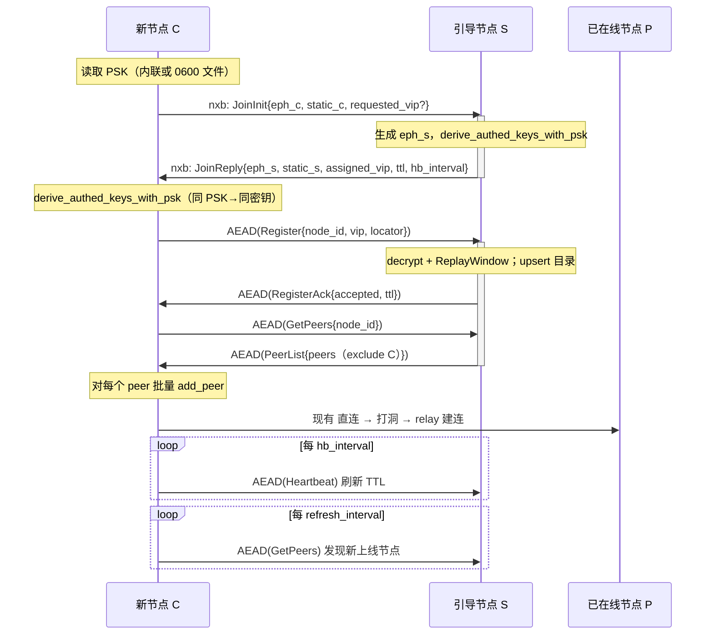

# Nexus Fabric · Bootstrap 自动入网设计

> 范围：两个功能——(A) 引导节点服务端；(B) 客户端装配接上 bootstrap。
> 设计原则：复用现有 UDP 承载与加密体系，**不新增任何加密原语、不新增端口、不破坏静态 peers 旧路径**。
> 本文只描述设计，不含最终实现代码；文中给出 Rust 接口骨架与对接点（文件路径对应当前 `bb6201b`）。

---

## 1. 目标与非目标

### 目标
1. 新机器入网只需：一个引导节点 `udp://host:port` + 全网 PSK，**无需静态列出任何 peer**。
2. 引导节点对新节点做 **PSK 认证**、**分配/确认 VIP**、返回**当前在线节点列表（VIP + locator）**。
3. 客户端拿到列表后批量 `add_peer`，后续建连**完全复用现有直连 → 打洞 → TURN/relay** 逻辑。
4. 在线状态靠心跳维持，节点掉线后其条目在 TTL 后自动从注册表清除。
5. 新节点入网后，后续上线的节点也能被已在线节点**周期性刷新发现**。

### 非目标（本期不做）
- 不做多引导节点之间的注册表同步（引导节点是单点权威；多引导仅作客户端侧故障转移）。
- 不替换 fabric 的 QUIC 传输；bootstrap 控制面走子网 UDP 隧道，不走 QUIC。
- 不做证书/PKI 体系，认证只用对称 PSK（与现有 `network_psk` 语义一致）。
- 不处理跨子网的 VIP 分配（本期限定单一 `[subnet].cidr`）。

---

## 2. 现状盘点：可直接复用的零件

| 能力 | 现有实现（位置） | 复用方式 |
|---|---|---|
| 控制帧类型 | `AutoDiscoveryFrame{Register,GetPeers,PeerList,Heartbeat}`（`nexus-discovery/src/auto_discovery.rs:201`） | **扩展**，新增 Join/JoinAck/Error |
| 帧编解码 | `encode_auto_frame` / `decode_auto_frame`（同文件 `:265/:302`） | 随枚举扩展 |
| 内存注册表 | `BootstrapRegistry::{register,get_peers,heartbeat}`（同文件） | 服务端内部状态的原型，**加 TTL/持久化** |
| VIP 分配 | `VirtualIpAllocator::{allocate, allocate_specific, len}`（`nexus-connectivity/src/coord.rs:202`，按 owner 幂等、冲突检测） | 服务端 VIP 权威分配 |
| 客户端自派生 VIP | `derive_vip(static_pub, cidr, nonce)`（`coord.rs:572`） | 客户端"申请 VIP"时使用 |
| PSK 加载/校验 | `load_network_psk`（`apps/nexus/src/subnet_cli.rs:292`，内联/0600 文件、互斥校验） | 客户端与服务端共用 |
| PSK 混合握手 | `derive_authed_keys_with_psk(static,eph,peer_static,peer_eph,initiator,psk)`（`encryption.rs:420`） | bootstrap 会话密钥派生 |
| AEAD + 防重放 | `encrypt_frame` / `decrypt_frame` / `ReplayWindow`（`encryption.rs:466/492/538`） | 控制帧加密与重放拦截 |
| 密钥对 | `KeyPair::{generate,from_seed,public_key_bytes}`（`encryption.rs:127`） | 节点持久/临时身份 |
| UDP 承载 | `PacketCarrier` trait + `UdpCarrier`（`nexus-platform/src/lib.rs:83`、`udp_carrier.rs`） | 控制帧与数据帧共用 socket |
| 对端装配 | `VirtualSubnetTunnel::{add_peer,set_peer_state,begin_hole_punch_multi}`（`virtual_subnet.rs`） | 拉回列表后批量调用 |

**结论**：协议帧、VIP 分配、PSK 认证的全部密码学零件都已存在且被测试覆盖；缺口只有四块——
①帧缺 Join/认证字段；②服务端 UDP 事件循环；③客户端 joiner；④`assemble_with` 接线。

---

## 3. 总体方案

- 引导节点是网内一个**普通节点**，额外开启一个可开关的"bootstrap 服务端"角色；它与数据面**共用同一个 UDP socket**。
- 复用数据面的"明文公钥握手 + PSK 派生会话密钥"模型：握手包只含 X25519 公钥（无秘密），**认证结果由"首个 AEAD 控制帧能否被对端解密"来证明**——PSK 错误则解密失败、拒绝入网。这与现有 PSK 数据面的安全模型逐字一致（见 `encryption.rs:414-419` 注释）。
- 控制帧用一个 **magic 前缀 `nxb:`** 与 NXP1 数据帧区分，在同一 socket 上分流。
- VIP 由服务端用 `VirtualIpAllocator` **权威分配**；客户端可带"申请值"，冲突时服务端回传"分配值"，客户端一律以服务端确认为准。

```text
                 ┌──────────────────────────────────────────┐
                 │        引导节点 S（普通节点 + 服务端角色）      │
                 │  BootstrapServer（UDP 事件循环，同 socket）    │
                 │   ├ ControlSession 表（每源：密钥+ReplayWindow）│
                 │   ├ BootstrapDirectory（node→VIP/locator/TTL） │
                 │   └ VirtualIpAllocator（VIP 权威，持久化）      │
                 └───────▲───────────────────────▲────────────┘
            JoinInit/控制帧 │                       │ JoinInit/控制帧
                  ┌────────┴───────┐       ┌───────┴────────┐
                  │ 新节点 A         │       │ 新节点 B         │
                  │ BootstrapJoiner │       │ BootstrapJoiner │
                  │ → 拉回 peers     │       │ → 拉回 peers     │
                  └────────────────┘       └────────────────┘
        A、B 各自 add_peer(对方) → 现有 直连/打洞/relay 建连
```

---

## 4. 入网时序



---

## 5. 线协议设计

### 5.1 复用端口的帧分流
UDP socket 收到数据报后按前缀分流（服务端与客户端入口一致）：

| 前缀 | 含义 | 处理路径 |
|---|---|---|
| `nxb:` | bootstrap 控制帧 | bootstrap 控制通道 |
| `ph:` / `pa:` | 打洞帧（现有） | `handle_hole_punch_frame` |
| 其它 | NXP1 数据帧（AEAD 二进制 / 明文帧头） | 现有 `recv_and_deliver` |

> `nxb` = **N**e**x**us **B**ootstrap。控制帧结构：`b"nxb:" + payload`。

### 5.2 帧枚举扩展
在 `AutoDiscoveryFrame` 之外新增一个独立枚举（避免改动已冻结的旧帧及其测试）：

```rust
// 建议新文件 crates/nexus-discovery/src/bootstrap_join.rs
pub const NXB_MAGIC: &[u8] = b"nxb:";

pub enum BootstrapJoinFrame {
    // C -> S，明文（仅 X25519 公钥 + 申请值，无秘密）
    JoinInit {
        eph_pub: [u8; 32],
        static_pub: [u8; 32],
        requested_vip: Option<String>, // None = 请服务端分配
        client_nonce: u64,             // 握手防重放/日志关联
    },
    // S -> C，明文
    JoinReply {
        eph_pub: [u8; 32],
        static_pub: [u8; 32],
        assigned_vip: String,          // 服务端权威确认
        lease_secs: u32,               // 注册租约
        hb_interval_ms: u32,
        refresh_interval_ms: u32,
        server_nonce: u64,
    },
    // 握手后：payload = AEAD(encode_auto_frame(AutoDiscoveryFrame))
    // 即 Register / GetPeers / PeerList / Heartbeat 全部复用现有帧，
    // 仅在其外层套一层会话 AEAD，不重复造控制消息。
    // 服务端错误：
    Error { code: BootstrapErrorCode, message: String },
}

pub enum BootstrapErrorCode {
    AuthFailed,      // PSK 错误 / AEAD 解密失败 / 重放
    BadVip,          // VIP 不在 CIDR / 非法
    VipConflict,     // 申请值被占（JoinReply 仍会带分配值；硬冲突用此码）
    NotBootstrap,    // 对端未开启服务端
    RateLimited,
    MalformedFrame,
}
```

编解码沿用 `auto_discovery.rs` 的确定性规则：`u16 BE` 长度前缀字符串、`u64 BE`、固定 32 字节公钥、数量用 `u16 BE`；未知 tag / 截断 / trailing bytes 一律 `Transport` 错误。

### 5.3 会话密钥与认证
- 双方各持持久 `static` 身份（`node init` 生成，服务端必须用持久身份；客户端默认也用持久身份）。
- JoinInit/JoinReply 交换临时 `eph` 公钥后，双方调用：
  ```rust
  // initiator = true（客户端）/ false（服务端）
  let keys = derive_authed_keys_with_psk(
      &my_static, &my_eph, &peer_static, &peer_eph, initiator, &psk)?;
  ```
- 此后控制帧：`nxb:` + `encrypt_frame(&keys.tx, seq, &encode_auto_frame(...))`；
  对端 `decrypt_frame(&keys.rx, ...)` 并过 `ReplayWindow::check_and_accept(seq)`。
- **PSK 不一致 → 派生密钥不同 → 首个控制帧 `DecryptionFailed` → 返回 `AuthFailed`、不落任何注册条目**。
- 握手防重放：`client_nonce/server_nonce` 纳入 AEAD 首帧的 AAD（或拼入 PSK 派生 salt），避免同一 JoinInit 被重放建立会话；数据面重放由 `ReplayWindow` 兜底。

### 5.4 VIP 分配规则（服务端权威）
1. `requested_vip = None` → `vip_allocator.allocate(now, node_id)`（按 node_id 幂等，重连拿回同一 VIP）。
2. `requested_vip = Some(v)`：
   - 先校验 `v ∈ cidr`；
   - `allocate_specific(now, node_id, v)`：成功则确认；
   - 若被**别的 node_id** 占用（`AddressInUse`），回退为 `allocate(now, node_id)` 另取一个，在 JoinReply 返回实际值（不报错，软冲突）。
3. 客户端以 `JoinReply.assigned_vip` 为最终 VIP，覆盖本地 `[subnet].virtual_ip` 与 `derive_vip` 结果。

---

## 6. 引导节点服务端设计（功能 A）

### 6.1 结构骨架
```rust
// crates/nexus-connectivity/src/bootstrap_server.rs
pub struct BootstrapServer {
    identity: KeyPair,                 // 服务端持久 static 身份
    psk: Vec<u8>,
    directory: BootstrapDirectory,     // 在线注册表（含 TTL）
    vip_allocator: VirtualIpAllocator, // VIP 权威
    sessions: HashMap<SessionKey, ControlSession>,
    cfg: BootstrapServerConfig,
}

struct ControlSession {
    keys: DirectionalKeys,
    replay: ReplayWindow,
    node_id: String,
    established_at: u64,
}

pub struct BootstrapDirectory {
    nodes: HashMap<String, DirectoryEntry>, // key = node_id
}
pub struct DirectoryEntry {
    pub node_id: String,
    pub virtual_ip: String,
    pub locator: String,   // 对端真实 UDP locator（取注册报文 NAT 来源或自报值）
    pub last_seen: u64,
    pub lease_secs: u32,
}
```

### 6.2 核心处理
```rust
impl BootstrapServer {
    /// 处理一个 UDP 数据报；返回需要回给 src 的数据报（可能为 None）。
    pub fn handle_datagram(&mut self, src: SocketAddr, dgram: &[u8], now: u64)
        -> Option<Vec<u8>>
    {
        let payload = dgram.strip_prefix(NXB_MAGIC)?;
        match decode_join_outer(payload) {
            Outer::JoinInit(init) => Some(self.handle_join_init(src, init, now)?),
            Outer::Secured(blob) => self.handle_secured(src, blob, now),
        }
    }

    fn handle_join_init(&mut self, src, init, now) -> Result<Vec<u8>> {
        // 1) 生成 eph_s；2) VIP 分配/确认（§5.4）；
        // 3) 预建 ControlSession（待首个 AEAD 帧验证）；4) 回 JoinReply。
    }

    fn handle_secured(&mut self, src, blob, now) -> Option<Vec<u8>> {
        let sess = self.sessions.get_mut(&SessionKey::from(src))?;
        let (seq, plain) = decrypt_frame(&sess.keys.rx, &blob).ok()?; // PSK 错→None→静默丢
        sess.replay.check_and_accept(seq).ok()?;
        match decode_auto_frame(&plain) {
            AutoDiscoveryFrame::Register { node_id, virtual_ip, locator } => {
                // locator 以 NAT 来源 src 为准（防自报伪造），self 报值仅作显示
                self.directory.upsert(node_id, virtual_ip, src, now, lease);
                Some(self.seal(&sess, &RegisterAck{..}))
            }
            AutoDiscoveryFrame::GetPeers { node_id } => {
                let peers = self.directory.to_discovered_nodes_except(&node_id);
                Some(self.seal(&sess, &PeerList{ peers }))
            }
            AutoDiscoveryFrame::Heartbeat { node_id, .. } => {
                self.directory.touch(&node_id, now);
                Some(self.seal(&sess, &RegisterAck{ accepted:true, .. }))
            }
            _ => None,
        }
    }

    /// 周期调用：清除 last_seen + lease < now 的条目，释放其 VIP。
    pub fn sweep_expired(&mut self, now: u64) -> SweepReport;
}
```

### 6.3 关键策略
- **locator 以 NAT 来源为准**：注册条目的可达地址取 UDP 报文真实源地址（`src`），不信任客户端自报 `locator`，防止伪造/污染。
- **租约与清扫**：`lease_secs` 内未收到 Heartbeat 即判定离线，`sweep_expired` 删除条目并释放 VIP（`VirtualIpAllocator` 需补一个按 owner 的 `release`，见 §9）。
- **服务端自身入册**：引导节点把自己（VIP + locator）作为目录第 0 个条目，新节点能直接与它建连。
- **持久化**：VIP 分配表（owner→VIP 映射）落盘到配置目录（复用 `task_store`/文件 KV 的 journal 写法），重启后保持 VIP 稳定；在线目录是易失的，重启后靠各节点心跳重建。
- **服务端不参与对数据内容的解密转发之外的行为**：它只做"入网网关 + 目录"，节点间数据流量不强制经过它（P2P 直连/打洞）。

---

## 7. 客户端装配设计（功能 B）

### 7.1 Joiner
```rust
// crates/nexus-connectivity/src/bootstrap_joiner.rs
pub struct BootstrapJoiner<'a> {
    carrier: &'a mut dyn PacketCarrier,
    identity: &'a KeyPair,
    psk: &'a [u8],
}
pub struct JoinOutcome {
    pub assigned_vip: String,
    pub peers: Vec<DiscoveredNode>,
    pub lease_secs: u32,
    pub hb_interval_ms: u32,
    pub refresh_interval_ms: u32,
}
impl<'a> BootstrapJoiner<'a> {
    /// 逐个尝试 bootstrap 节点，首个完成握手+注册+拉表即返回。
    pub fn join(&mut self, servers: &[BootstrapConfig], requested_vip: Option<&str>,
                deadline: Duration) -> Result<JoinOutcome, BootstrapJoinError> {
        for s in servers {
            match self.try_join_one(s, requested_vip, deadline) {
                Ok(o) => return Ok(o),
                Err(NotBootstrap|AuthFailed|Timeout) => continue, // 换下一个引导
                Err(e) => return Err(e),
            }
        }
        Err(BootstrapJoinError::AllBootstrapFailed)
    }
}
```
收发基于 `PacketCarrier::send_to/receive_into`（非阻塞轮询 + 超时），与 `subnet_punch` 的收包循环同一套写法，不引入 async。

### 7.2 `assemble_with` 改造（核心接线点）
当前 `assemble_with`（`apps/nexus/src/subnet_cli.rs:534`）只消费静态 `peers`。改造为**先 bootstrap、再叠加静态 peers**：

```rust
fn assemble_with(config, vpi, carrier) -> Result<VirtualSubnetTunnel> {
    let s = &config.subnet;
    let psk = load_network_psk(s)?;                 // 已存在
    // —— 新增：bootstrap 自动入网 ——
    let mut bootstrap_outcome: Option<JoinOutcome> = None;
    if !s.bootstrap.is_empty() {
        let psk = psk.as_ref().ok_or("PSK_REQUIRED")?; // 现有 fail-closed 校验
        // carrier 在真实模式已由 assemble_real_tunnel 绑定；默认模式先 bind 临时端口
        let requested = s.virtual_ip.as_deref();
        bootstrap_outcome = Some(BootstrapJoiner::new(carrier.as_mut(), identity, psk)
            .join(&s.bootstrap, requested, JOIN_DEADLINE)?);
    }
    // 以确认 VIP 建立隧道
    let effective_vip = bootstrap_outcome.as_ref()
        .map(|o| o.assigned_vip.clone())
        .or_else(|| s.virtual_ip.clone())
        .ok_or("VIRTUAL_IP_UNRESOLVED")?;
    let mut tunnel = VirtualSubnetTunnel::new(
        VirtualSubnetConfig::new(s.cidr.clone(), effective_vip), vpi, carrier);

    // 1) bootstrap 拉回的 peers
    if let Some(o) = &bootstrap_outcome {
        for n in &o.peers {
            tunnel.add_peer(TunnelPeer::new(&n.virtual_ip, &n.locator))?;
            // 不预置 Connected：交给现有 直连/打洞/relay 流程推进状态
        }
    }
    // 2) 静态 peers（向后兼容，可与 bootstrap 并存）
    for peer in &s.peers { tunnel.add_peer(...)?; tunnel.set_peer_state(...); }
    // 3) 路由 / 前缀 / 本地前缀 / egress / encryption（保持现有顺序）
    ...
    // 4) 记录心跳/刷新参数，交给常驻循环（§7.3）
    Ok(tunnel)
}
```

### 7.3 常驻后的心跳与刷新
- **CLI `--foreground` / daemon 模式**：在现有常驻轮询循环中新增两个计时（不新增线程也可，复用轮询 tick）：
  - 每 `hb_interval_ms`：向引导节点发 AEAD `Heartbeat`；
  - 每 `refresh_interval_ms`：发 AEAD `GetPeers`，对**新出现**的 node 补 `add_peer`，对消失的 node 标记降级（不立即删，避免抖动）。
- **一次性 `subnet up`（不常驻）**：完成 join + 拉表 + 写状态即返回，心跳由后续真正持有隧道的进程负责（与现状语义一致）。
- 引导节点不可用：客户端标记 `BootstrapStale`，**已建立的 P2P 连接不受影响**；恢复后重新注册。

### 7.4 客户端故障转移
- `bootstrap` 数组按序尝试，`AuthFailed`（PSK 不符通常全网一致，可快速失败）、`NotBootstrap`、超时则切换下一个。
- 成功后若当前引导在租约期内失联，可在下个刷新周期改连备用引导重新注册（VIP 由 node_id 幂等，换引导仍拿回同 VIP——前提是引导间不冲突，本期作为可接受限制并在文档注明）。

---

## 8. 配置变更

### 8.1 引导节点（开启服务端角色）
新增可选表，缺失 = 普通节点（服务端不启用）：
```toml
[subnet]
cidr = "10.144.144.0/24"
virtual_ip = "10.144.144.1"
encryption = true
network_psk_file = "/etc/nexus/psk.key"   # 复用现有 PSK；服务端与客户端必须一致

[subnet.bootstrap_server]
enabled = true
lease_secs = 60                 # 注册租约（建议 3×hb_interval）
hb_interval_ms = 20000
refresh_interval_ms = 60000
# state 落 <config-dir>/bootstrap/（VIP 分配表持久化）
```

### 8.2 新节点（客户端，最简）
沿用已存在的 `[[subnet.bootstrap]]`，**零静态 peer**：
```toml
[subnet]
cidr = "10.144.144.0/24"
encryption = true
network_psk_file = "/etc/nexus/psk.key"
# virtual_ip 不填：由服务端分配

[[subnet.bootstrap]]
address = "udp://203.0.113.10:11010"
name = "vps-bootstrap"
# 可再列一个备用引导
```
运行命令不变：`nexus subnet up --config node.toml --foreground`（或 `--tun`）。

> 校验规则沿用现有：bootstrap 非空则 PSK 必填、地址必须 `udp://`；新增对 `[bootstrap_server]` 的字段范围校验（lease>0、间隔>0、`enabled` 为 bool），未知键报错。

---

## 9. 需要小幅补齐的现有能力

| 缺口 | 说明 | 建议 |
|---|---|---|
| `VirtualIpAllocator::release(owner)` | 现仅有分配，无按 owner 释放 | 新增幂等释放，供过期清扫与 leave 调用 |
| carrier 入口分流 | `VirtualSubnetTunnel` 收包需先识别 `nxb:` | 在 `recv_and_deliver` 最前面加分流，转发给 `BootstrapServer` |
| 服务端持有位置 | daemon/CLI 组合根需拥有 `BootstrapServer` | 与 tunnel 同生命周期；`--tun` 真实模式共用 UDP socket |
| 握手 nonce 绑定 | `derive_*_with_psk` 当前不吃 nonce | 将 client/server nonce 并入首帧 AAD 或 salt，避免握手重放 |

均为局部、向后兼容的增量，不改动已冻结帧的字节布局。

---

## 10. 安全与错误处理矩阵（fail-closed）

| 场景 | 行为 |
|---|---|
| 无 PSK 且配置了 bootstrap | 装配前拒绝：`PSK_REQUIRED`（现有） |
| PSK 错误 | 首个 AEAD 帧解密失败 → `AuthFailed`，**不注册、不返回列表、不建连** |
| 重放旧控制帧 | `ReplayWindow` 拒绝；握手重放由 nonce/AAD 拒绝 |
| 申请 VIP 不在 CIDR | `BadVip`，拒绝并回服务端分配值 |
| 申请 VIP 被他人占用 | 软冲突：服务端另分配并在 JoinReply 注明 |
| 对端未开服务端 | 收不到 JoinReply/前缀不符 → `NotBootstrap`，切换备用引导 |
| 全部引导不可达 | `AllBootstrapFailed`，进程非零退出并打印各引导原因 |
| 伪造 locator | 目录以 NAT 源地址为准，忽略自报值 |
| 控制帧格式损坏 | `MalformedFrame`，静默丢弃不回敏感信息 |
| 引导重启 | VIP 表持久化保持稳定；在线目录靠心跳重建 |

---

## 11. 分阶段落地

| 阶段 | 内容 | 证据等级 |
|---|---|---|
| P1 | `bootstrap_join.rs` 帧 + 编解码 + 单测；`VirtualIpAllocator::release` | 离线单测 |
| P2 | `BootstrapServer` 纯逻辑（`MemoryCarrier` 连接对）：认证、分配、目录、过期 | E4 |
| P3 | `BootstrapJoiner` + `assemble_with` 接线；心跳/刷新轮询 | E4 |
| P4 | 真实 UDP：单 socket 前缀分流、服务端角色、VIP 表持久化 | E5（loopback） |
| P5 | 真机/NAT、多引导故障转移、异常断电恢复 | E5（真机） |

---

## 12. 验证计划

### E4（离线确定性，进 CI）
- 新增 harness 场景：`nexus-harness run bootstrap-join --json`，断言：
  - 新节点 `static_peers=0` 入网成功、`assigned_vip` 在 CIDR；
  - `PeerList` 含已在线节点；`add_peer` 数量正确；
  - 三节点经引导互相发现后，A→C 数据可达（复用 `virtual-subnet-mesh` 断言）。
- 单测矩阵：PSK 错误被拒、VIP 冲突重分配、租约过期释放、握手/帧重放被拒、全引导失败、`nxb:` 与数据帧在同一 carrier 上正确分流。

### E5（真实链路）
- 单机 loopback：起 1 个引导（`[bootstrap_server]`）+ 2 个零静态 peer 新节点：
  ```bash
  sudo nexus subnet up --config server.toml --tun --listen udp://127.0.0.1:11010 --foreground
  sudo nexus subnet up --config node-a.toml --tun --listen udp://127.0.0.1:11011 --foreground
  sudo nexus subnet up --config node-b.toml --tun --listen udp://127.0.0.1:11012 --foreground
  ```
  验证：两新节点 `subnet status` 中互见对方、`tcpdump` 见 P2P UDP、心跳维持、杀掉一个节点后其条目在租约后消失、VIP 被回收。
- 真机：引导放 VPS（公网 UDP），内网节点零配置入网，验证对称 NAT 下经打洞/relay 互通。

---

## 13. 兼容性与影响面
- 旧配置（无 `bootstrap`、无 `bootstrap_server`）路径字节级不变，现有测试与场景全绿。
- `bootstrap` 与静态 `peers` 可并存：bootstrap 负责发现，静态项用于固定骨干/引导本身。
- 新增文件为主，仅 `recv_and_deliver`（加前缀分流）、`assemble_with`（加入网分支）、`VirtualIpAllocator`（加 release）三处局部改动。
- 不新增第三方依赖；编解码、密码学、承载全部复用现有实现。
